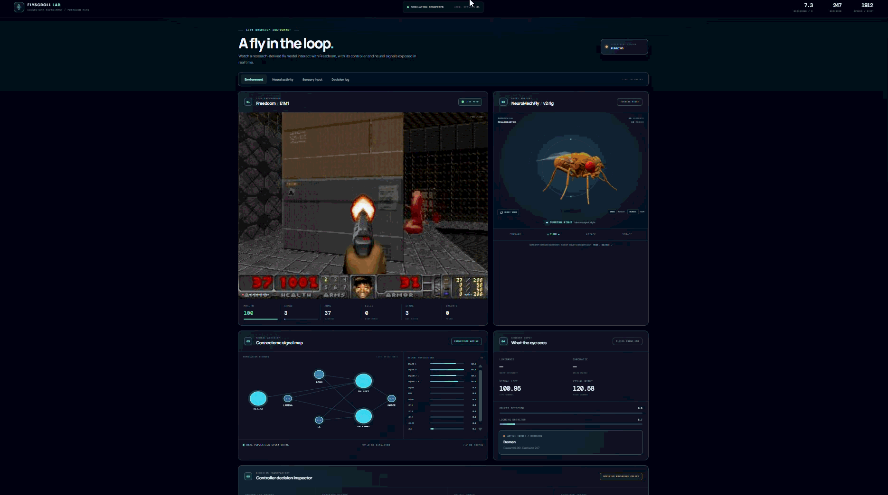

# Fruit Fly Doom

**Can a simulated fruit-fly brain learn to play DOOM?** This project explores that question by connecting a fruit fly's simulated visual system and brain to a DOOM-like game.

It uses [FlyScroll](https://github.com/ravvdevv/Fruit-Fly-DoomScroll) to simulate part of a *Drosophila* (fruit fly) nervous system. The long-term idea is to turn what the simulated brain sees into simple game controls.

> **Research status:** This is an early experiment. A small test detected motion-direction information in simulated neural activity, but the project has not demonstrated a fruit-fly connectome independently playing or completing DOOM.

## Live dashboard



The dashboard streams game frames and simulation telemetry while the FlyScroll adventure pilot is running. It displays the game view alongside the fly's 3D model, neural activity, visual signals, and current actions. The image above is a static snapshot of the dashboard, not a gameplay recording.

## How it works

1. **The game produces an image.** The system captures a frame from DOOM or Freedoom.
2. **The fly's visual system processes it.** FlyEye turns the image into visual signals.
3. **The simulated brain processes those signals.** FlyScroll runs a model of the fruit fly's nervous system.
4. **A readout looks for movement.** An experimental decoder examines neural activity and predicts the direction of visual motion.
5. **The experiment can send a control.** Turning predictions into reliable game actions is still being tested.

A separate game pilot also exists. It uses ordinary programmed rules and game information, so it is not the same as playing with neural activity alone.

## What has been tested?

### Motion detection

In an initial experiment, the system watched simple moving-bar patterns:

| Measurement | Result |
| --- | ---: |
| Neural readout accuracy | 78.3% |
| Visual-feature check | 80.0% |
| Trials | 10 (5 per direction) |

These early results suggest that simulated neural activity contains information about motion direction. The test used simple artificial images, not actual DOOM gameplay. More trials and independent testing are needed.

### Finding a target

A separate experiment tried to tell whether a static target was on the left or right:

- Accuracy: **53.1%**
- Trials: **8**
- Permutation test p-value: **0.2**

This is not strong evidence that the system can reliably locate targets.

## Project structure

The repository is organized by purpose:

```text
Fruit-Fly-Doom/
├── experiments/             # Research scripts and experiment results
│   └── results/             # Committed reference results
├── dashboard/               # Adventure pilot dashboard
├── neural_viz_frontend/     # Neural visualization dashboard
├── prototypes/
│   └── browser-raycaster/   # Standalone browser game prototype
├── connectome_doom.py       # Experimental game-to-connectome bridge
├── play_flyscroll_adventure.py
├── neural_viz_server.py
├── calibrated_flyvision.py
├── neural_motor_decoder.py
├── neural_motion_readout.npz
├── neural_motion_samples.npz
├── launch-*.bat             # Windows launch scripts
├── run-*.bat
├── requirements-viz.txt
└── README.md
```

Temporary test scripts, debug logs, downloaded game files, and local Python environments are not part of the repository.

## What you need

This project currently targets **Windows 10/11** and uses:

- Python 3.11 for the original FlyScroll environment
- [FlyScroll / Fruit-Fly-DoomScroll](https://github.com/ravvdevv/Fruit-Fly-DoomScroll)
- [GZDoom](https://zdoom.org/downloads), the game engine
- [Freedoom](https://github.com/freedoom/freedoom/releases), free game files compatible with the engine
- The Python packages listed in `requirements-viz.txt` for the dashboard

Download GZDoom and Freedoom separately. They are intentionally not included in this repository.

Expected local folders:

```text
Fruit-Fly-Doom/
├── gzdoom-4-14-2-windows/
│   └── gzdoom.exe
└── freedoom-0.13.0/
    └── freedoom1.wad
```

Place the original FlyScroll checkout beside this repository:

```text
Experimental-projects/
├── Fruit-Fly-Doom/
└── Fruitfly-Doomscroller/
```

The launch scripts look for FlyScroll in that neighboring folder by default. You can override it by setting the `FLYSCROLL_ROOT` environment variable or passing `--flyscroll-root` where supported. Follow FlyScroll's own setup instructions to prepare its Python environment and connectome data.

## Run it

### 1. Start Freedoom

After installing GZDoom and Freedoom in the folders above, run:

```bat
launch-freedoom.bat
```

This starts the game by itself. It does not start the neural controller.

### 2. Open the neural dashboard

Run:

```bat
launch-neural-viz.bat
```

Then open [http://127.0.0.1:8765/viz](http://127.0.0.1:8765/viz) in your browser.

The dashboard displays neural and visual-processing information when a simulation sends it data. Without a running simulation, some panels will be idle.

### 3. Try the experimental controller safely

Dry-run mode observes game frames and prints predictions without pressing keys:

```bat
run-connectome-doom.bat --scale full --motion-decoder --dry-run --frames 200
```

The motion decoder needs the full 166,700-neuron graph and the included `neural_motion_readout.npz` model.

Actual keyboard control is deliberately disabled unless you explicitly add `--allow-experimental-live-control`. The decoder has not yet been validated on real gameplay, so start with dry-run mode.

## Research scripts

Run these from the repository root with the FlyScroll Python environment:

| Script | What it does |
| --- | --- |
| `experiments/neural_pathway_probe.py` | Tests how the simulated brain responds to visual patterns |
| `experiments/neural_drive_calibration.py` | Tests different visual input settings |
| `experiments/neural_motion_decode.py` | Tests whether neural activity can identify motion direction |
| `experiments/neural_target_decode.py` | Tests whether neural activity can identify a target's side |

For example:

```bat
..\Fruitfly-Doomscroller\.venv\Scripts\python.exe experiments\neural_motion_decode.py
```

New experiment reports are written to `experiments/results/latest/`. The committed files directly inside `experiments/results/` are reference results from earlier runs.

## Current status

- [x] Connect visual input to the FlyScroll simulation
- [x] Run early visual-response experiments
- [x] Train an initial motion-direction readout
- [x] Add an experimental game connection
- [x] Provide a dry-run mode that does not press game controls
- [ ] Test the decoder on real DOOM gameplay footage
- [ ] Improve target detection
- [ ] Validate how neural predictions should control movement
- [ ] Demonstrate reliable gameplay using neural activity alone

## Credits

- [FlyScroll / Fruit-Fly-DoomScroll](https://github.com/ravvdevv/Fruit-Fly-DoomScroll) for the connectome simulation and visual-processing foundation
- [GZDoom](https://zdoom.org/) for the game engine
- [Freedoom](https://freedoom.github.io/) for free DOOM-compatible game assets

Check each upstream project's license before redistributing its software or assets.

---

**This is an experimental computational-neuroscience project, not a working biological fruit-fly DOOM player.**
